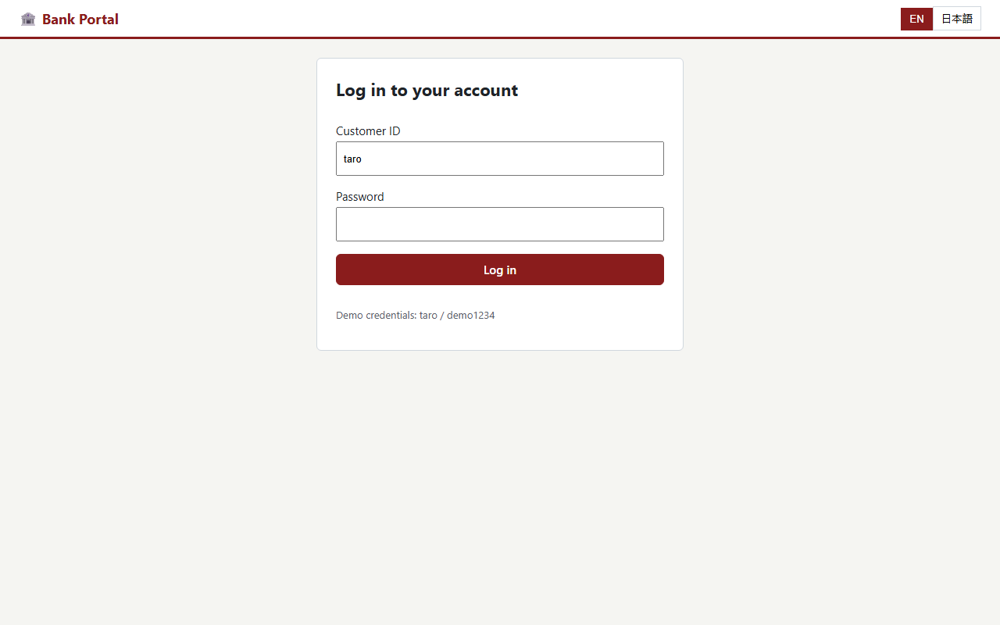
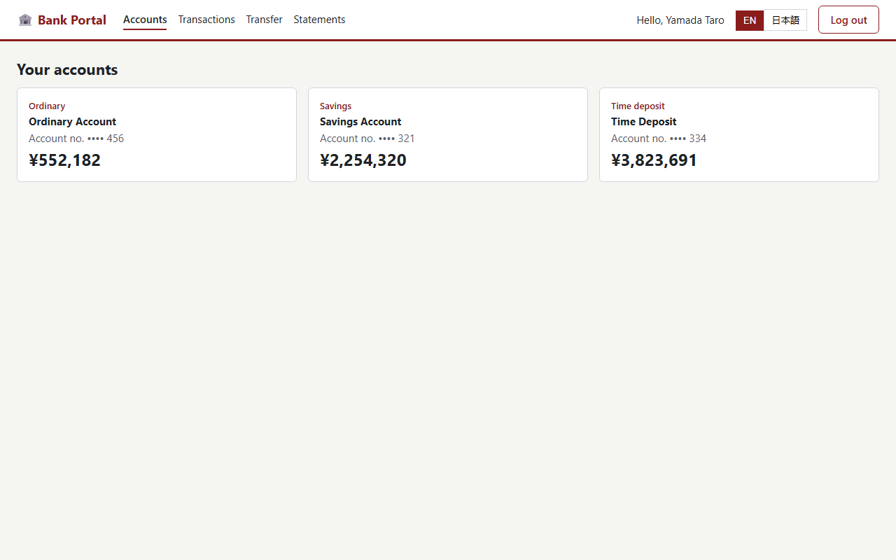
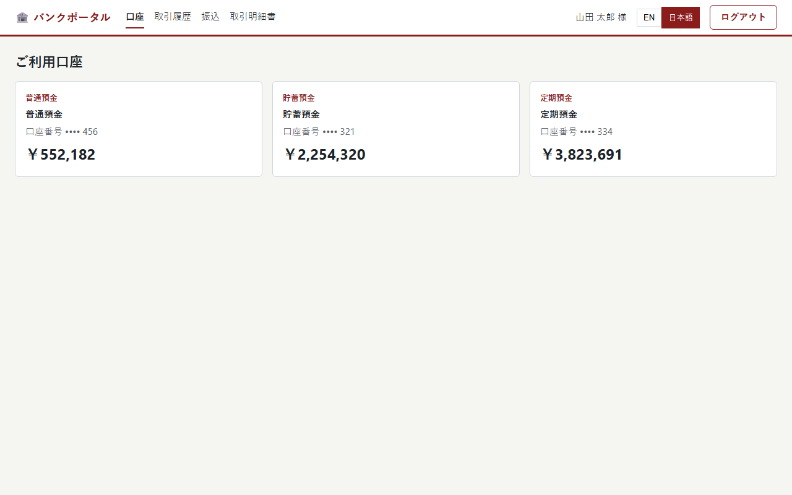
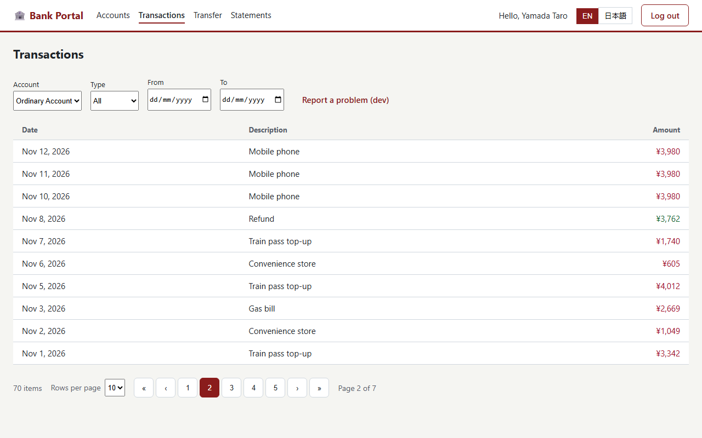
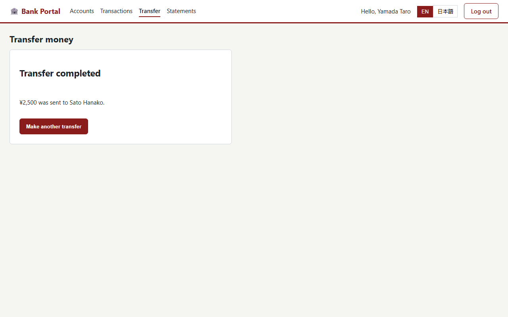
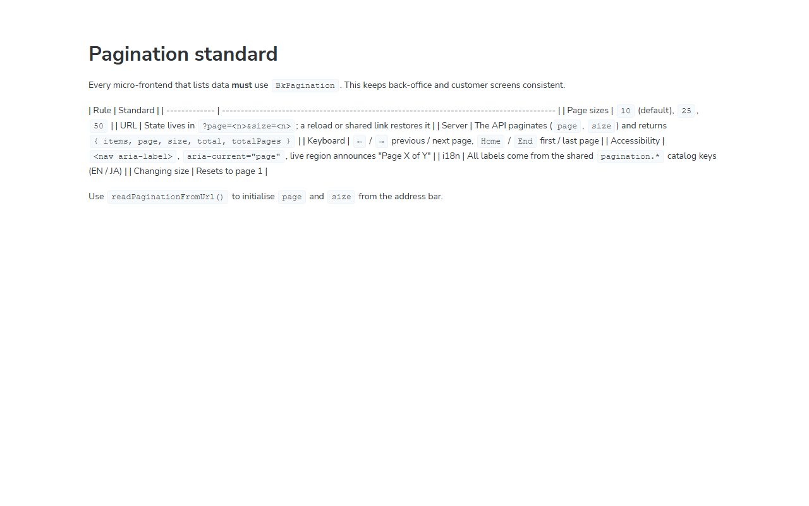
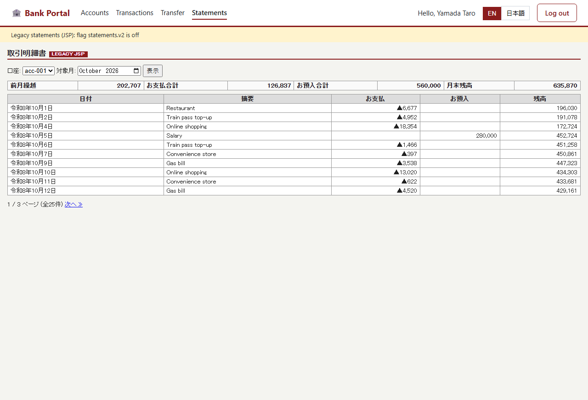
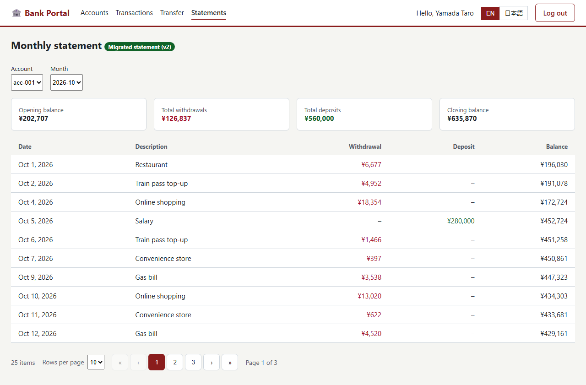

# Bank Portal Microfrontends: strangling a JSP banking portal with Vue 3

## The problem

A bank's customer portal runs on JSP pages served by Tomcat. Rewriting it in one go is too risky for a system that moves money, so the migration has to happen **one route at a time**, with an instant way back. I built the target architecture end to end:

- a **single-spa** shell that owns routing and mounts independently built micro-frontends;
- **Vue 3 + TypeScript** MFEs (navbar/login, accounts, transactions, statements) and one **React 19** MFE (transfer), sharing auth, i18n, analytics and feature flags through one `@bank/utility` module;
- a **legacy JSP parcel** for pages that are not migrated yet, and an **AWS AppConfig flag** (`statements.v2`) that decides, per route, whether `/statements` mounts the JSP or the Vue page;
- a shared UI library with the company-wide **pagination standard** (`BkPagination`), documented in Storybook;
- EN/JA throughout, Sentry + CloudWatch RUM, and delivery from S3 + CloudFront.

It runs locally with Docker and was deployed to AWS with Terraform, tested against the live CloudFront URL, then destroyed.

## Architecture

```mermaid
flowchart TB
  user([Customer]) --> cf[CloudFront]
  cf -->|"/ , /mfe/*"| s3[(S3: root-config, importmap.json, MFE bundles)]
  cf -->|"/api/*"| bff[Lambda BFF - Fastify]
  cf -->|"/legacy/*"| alb[ALB] --> tomcat[ECS Fargate - Tomcat 10 JSP]
  subgraph browser[Browser]
    root[single-spa root config + layout engine] --> nav[@bank/navbar Vue]
    root --> acc[@bank/accounts Vue]
    root --> tx[@bank/transactions Vue]
    root --> tr[@bank/transfer React]
    root --> st{statements.v2?}
    st -- off --> legacy[legacy JSP parcel - iframe]
    st -- on --> stv[@bank/statements Vue]
    util[@bank/utility: auth, i18n, analytics, flags]
    ui[@bank/ui: BkPagination, BkTable, BkButton, BkMoney]
  end
  bff --> appconfig[AppConfig flags]
  browser --> rum[CloudWatch RUM] & sentry[Sentry]
```

The import map (`importmap.json`) is the only coupling point between the shell and the MFEs. Each MFE is a separate Webpack 5 build deployed to `/mfe/<name>/<version>/`. PlantUML versions of the diagrams are in [`architecture.svg`](architecture.svg) and [`strangler-flow.svg`](strangler-flow.svg).

## Stack to requirement

| Requirement                                          | Where it shows up                                                                                                               |
| ---------------------------------------------------- | ------------------------------------------------------------------------------------------------------------------------------- |
| Vue.js + TypeScript frontend                         | Four Vue 3 MFEs (Composition API, Pinia, Vue Router) and `@bank/ui`, strict TypeScript, `vue-tsc` in CI                         |
| Legacy JSP modernisation, step by step               | `legacy/` (Tomcat 10, Java 21, Maven), iframe parcel, `statements.v2` flag, [migration notes](migration/statements.md)          |
| React alongside Vue                                  | `apps/mfe-transfer-react` (React 19, `single-spa-react`)                                                                        |
| single-spa (root config, layout engine, import maps) | `apps/root-config`, `importmap.json`, SystemJS                                                                                  |
| Align API requirements with backend                  | [`api-contract.md`](api-contract.md), [`openapi.yaml`](openapi.yaml), typed client in `@bank/utility`                           |
| Engineering standards / code review                  | ESLint + Prettier, PR template, [`CONTRIBUTING.md`](../CONTRIBUTING.md), pagination standard                                    |
| Webpack, Jest, Storybook, Playwright                 | Webpack 5 per MFE, Jest (+ Testing Library), Storybook 8 + a11y + test-runner, Playwright e2e                                   |
| i18n                                                 | vue-i18n + shared EN/JA catalogs, `Intl` date and currency formatting                                                           |
| Monitoring / analytics                               | `@sentry/vue` (MFE tag, no-op without DSN), analytics adapter: console locally, **CloudWatch RUM** in the cloud                 |
| Remote config                                        | **AWS AppConfig** flags delivered through the BFF (local JSON file in dev)                                                      |
| Secure frontend                                      | HttpOnly signed cookie (no tokens in JS), CSP and security headers from a CloudFront response-headers policy, `npm audit` in CI |
| Performance                                          | Lazy chunks, Lighthouse CI budget on `/accounts` (performance 1.0 locally), RUM web vitals                                      |
| CDN / hosting                                        | CloudFront with S3 (OAC), Lambda URL and ALB origins and per-path cache policies                                                |
| IaC / CI                                             | Terraform (`infra/`), GitHub Actions (lint, Jest, Storybook, Playwright, Lighthouse, diagram render, `terraform validate`)      |
| RESTful API design                                   | Fastify BFF: pagination standard, error codes, OpenAPI                                                                          |
| AI/LLM in development                                | [`AI_USAGE.md`](AI_USAGE.md)                                                                                                    |

## Screenshots

|                                                                            |                                                                                                 |
| -------------------------------------------------------------------------- | ----------------------------------------------------------------------------------------------- |
|                    |                             |
|        |              |
|  |  |

**Before and after the flag flip (same URL, same totals):**

| Flag off: legacy JSP in the parcel                                            | Flag on: migrated Vue page                                                    |
| ----------------------------------------------------------------------------- | ----------------------------------------------------------------------------- |
|  |  |

**On AWS (CloudFront):** [accounts](../proof/phase2-cloud/screenshots/01-cf-accounts.png), [legacy statements](../proof/phase2-cloud/screenshots/02-cf-statements-legacy.png), [migrated statements after the AppConfig deployment](../proof/phase2-cloud/screenshots/03-cf-statements-v2.png), [Japanese](../proof/phase2-cloud/screenshots/04-cf-ja.png). The cloud run also saved the [RUM events](../proof/phase2-cloud/logs/rum-events.json), the [AppConfig deployment log](../proof/phase2-cloud/logs/appconfig-deploy.log), the [security headers](../proof/phase2-cloud/logs/curl-headers-csp.txt) and the [resource list](../proof/phase2-cloud/resources.txt). The teardown evidence is in [`verify-destroyed.txt`](../proof/phase3-destroy/verify-destroyed.txt).

## What was hard

- **Proving the migration is faithful.** The Playwright test fetches the JSP HTML, reads its four `data-total` cells and asserts the Vue page renders the same numbers. The rules I kept, improved or removed are written down per rule in the migration notes.
- **SystemJS and lazy chunks.** SystemJS runs a module without `document.currentScript`, so webpack's automatic public path sent the lazy RUM chunk to the site root in the cloud (it worked locally because nothing lazy loaded). The utility module now derives its public path from `__system_context__.meta.url`.
- **A strict CSP versus real telemetry.** `script-src 'self'` is easy; CloudWatch RUM then needed Cognito (classic flow, enabled in Terraform) and the STS endpoint in `connect-src`. The cloud e2e test asserts that RUM requests are actually sent.
- **Stateless Lambda.** Transfers kept in server memory differed between Lambda instances. They now live in the signed HttpOnly session cookie, so every instance, warm or cold, shows the same balances.
- **AppConfig details.** The FeatureFlags profile type rejects flag names containing a dot, so `statements.v2` uses a Freeform profile with the same JSON shape. `AppConfig.AllAtOnce` bakes for 10 minutes, so the destroy script waits for deployments to finish, then bypasses AppConfig deletion protection (the live BFF had just read the environment) for an environment that is being removed on purpose.
- **Tooling edges.** Pinia 4 is ESM only (Jest needed `customExportConditions` and a transform), Storybook's test-runner had to be pinned to match Storybook 8, and the JSP needed the JSTL API jar next to its implementation.
- **Latency exposes races.** Two flaky-looking cloud failures were real UI problems: an empty-table flash before the first load and a transfer form that could be submitted before its accounts had loaded. Both are fixed in the product, not worked around in the tests.

## Approximate AWS cost

The stack was alive for about 70 minutes in `ap-southeast-2`. The cost is dominated by one ALB and one 0.25 vCPU / 0.5 GB Fargate task (roughly US$0.04 and US$0.02 for that time); Lambda, S3, CloudFront (PriceClass_100), AppConfig and RUM are within free tiers or cents. **Estimate: under US$0.50 in total** (computed from list prices, not read from a bill). There is no NAT gateway, no database and no reserved capacity.

## Reproduce

```bash
git clone https://github.com/mini4141/bank-portal-microfrontends && cd bank-portal-microfrontends
npm ci && npx playwright install chromium
scripts/test-all.sh                  # every local test layer, reports in proof/phase1-local/tests
scripts/dev-up.sh                    # http://localhost:9000, login taro / demo1234
scripts/capture-proof.sh phase1-local

# AWS (needs the bank-portal-microfrontends-deployer profile; costs a few cents)
scripts/deploy.sh                    # Terraform, upload, CloudFront, cloud Playwright, AppConfig flip
scripts/destroy.sh && scripts/verify-destroyed.sh
```
